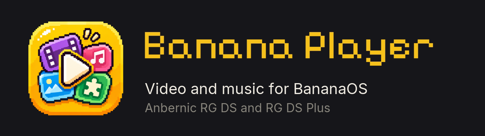

  

  <b>Your RG DS is a little cinema. Films, music, photos and manga on the top screen, big easy controls on the touch screen below.</b>

  <a href="#install">Install</a> ·
  <a href="#the-basics">The basics</a> ·
  <a href="FEATURES.md">All features</a> ·
  <a href="#something-wrong">Help</a>

Banana Player is a free video, music and photo player for [BananaOS](https://github.com/JorreFog/BananaLinux) on the
Anbernic RG DS and RG DS Plus. Drop your files on the SD card, pick one, and watch. It remembers where you stopped a film,
switches subtitles and audio tracks in a tap, turns a folder of songs into an album, lets you zoom around your
photos with a finger, and reads manga across both screens. When a new version is out, it installs in one tap.

<table>
  <tr>
    <td align="center" width="33%"> <b>Your files.</b> Icons, sizes, and where you left off in each film</td>
    <td align="center" width="33%"> <b>Watching.</b> Seek, skip, chapters, speed, subtitles and audio tracks, by button or by touch</td>
    <td align="center" width="33%"> <b>Music.</b> Album art, a visualizer, or both (here: Circle)</td>
  </tr>
  <tr>
    <td align="center"> <b>Sound.</b> A 10-band equalizer with presets, and room effects like Concert hall</td>
    <td align="center"> <b>Photos.</b> Zoom in and drag the box to look around</td>
    <td align="center"> <b>Settings</b> as tiles, with a help line for each and a live subtitle preview</td>
  </tr>
</table>

## Why you'll like it

- 🎬 **Videos:** MP4, MKV, AVI and more, with subtitles and audio tracks you can switch mid-film, and chapters you can jump between with L2 and R2, and playlists that mix your card and network.
- 🎵 **Music:** a folder plays as an album, with the cover art, a visualizer, or both. Audiobooks (M4B) keep their chapters.
- 🎚️ **A real equalizer and room effects:** ten bands, twelve presets (Bass Boost, Vocal, Rock, Jazz…) and your own saved ones, plus Concert hall, Church, Cave, Wide stereo and a Headphones mode. Heard the moment you change it. It shapes the handheld's sound; set it there or from the web dashboard.
- ❤️ **Playlists and Liked:** make playlists from your card and your network, and tap the heart on anything playing to keep it in Liked.
- 🖼️ **Photos:** zoom in, look around, step through a folder; scanned comics keep your zoom from page to page.
- 📖 **Manga reader** (an extension, turned on in **Manage extensions**): read CBZ files and folders of pictures from
  your card, a long strip across both screens or page by page, right to left or left to right. Add series from
  repositories you choose, your own comic server (Komga, Kavita, OPDS) or a network folder, and download chapters to
  read offline. Banana Player doesn't provide or check any repository's content.
- 📡 **From your computer or NAS:** play straight from shared folders on your Wi-Fi (SMB or FTP), with nothing copied to the card.
- 🌐 **Web dashboard:** manage files and playlists, upload from your computer, control the handheld, or play a song or film in your phone's or computer's browser. Scan the QR code on the handheld.
- 👆 **Built for two screens:** the picture on top, every control a big button under your thumb below. Every page has the same header and a footer that names the buttons, and an on-screen keyboard takes care of typing.
- 💾 **Remembers for you:** where you stopped a film, which subtitles you chose, what you played recently.
- 🔄 **One-tap updates** when a new version is out, with no re-copying files to the SD card. Your settings stay put.

Videos play on the handheld's CPU. The various 1080p videos we tested play well; very high bitrates, and HEVC (x265) especially, may drop frames.

## Install

> [!TIP]
> **Latest: [Banana Player 0.7.2](https://github.com/tonywei92/banana-player/releases/tag/v0.7.2)**, for BananaOS on the
> Anbernic RG DS and RG DS Plus.

1. **Download** `BananaPlayer-0.7.2-aarch64.zip` from [the release](https://github.com/tonywei92/banana-player/releases/tag/v0.7.2).
2. **Unzip it into `roms/ports`** on your SD card. You should end up with `Banana Player.sh`, a `BananaPlayer` folder
   and a `media` folder there. (On a Mac, if the zip opens into a folder of its own, move those three out of it.)
3. **Play:** put the card back in, open the **Ports** shelf and choose **Banana Player**.

Your videos, music and photos can live anywhere on the card. From then on, Banana Player tells you when a new
version is out and installs it for you.

## The basics

The buttons follow the Nintendo layout: **A** confirms, **B** goes back.

- **Home:** what you played recently along the top, then **Files**, **Playlists**, **Network** and **Extensions**.
  **L / R** move between them; **B** at the top of one comes back Home, and **B** on Home asks to quit.
- **Open something:** tap it, or press **A**. A folder plays as a playlist.
- **Play / pause:** **A**. **L / R** go to the previous or next file.
- **Close it:** tap **<** at the top left, or press **B** twice.
- **Like it:** tap **Like** (or click **L3** on the RG DS Plus); it goes to **Liked**. **Add** puts it in a playlist.
- **Skip back or ahead:** **LEFT** goes back 5 seconds, **RIGHT** forward 10, or drag the bar.
- **Network:** **X** then **Find on the network** finds your computer.
- **Options** (refresh, hide a folder; on Network, add a connection): **X**.
- **Menu** (what's playing, Settings, About): **START**. **L / R** switch its tabs.
- **Quick settings** (volume, brightness, the web dashboard, quit): press the **Menu/Function** button.
- **Quit straight away:** **F + START**.

The bottom line of every page shows what the buttons do there.

Every button has a touch equivalent on the bottom screen. Every control, setting and format is in
**[FEATURES.md](FEATURES.md)**.

## Something wrong?

Plug the SD card into a computer and attach `home/.config/banana-player/log.txt` to an
[issue](https://github.com/tonywei92/banana-player/issues), and `crash.log` beside it if there is one (it keeps a
record of every crash). To uninstall, delete `Banana Player.sh`, the
`BananaPlayer` folder and `media/box/Banana Player.png` from `roms/ports`.

Want to build it or help out? See [DEVELOPMENT.md](DEVELOPMENT.md).

## Credits

- Made by [tonywei92](https://github.com/tonywei92) for [BananaOS](https://github.com/JorreFog/BananaLinux) by
  JorreFog and the Banana contributors.
- Plays with [mpv](https://mpv.io) and [FFmpeg](https://ffmpeg.org). Drawn with [SDL](https://libsdl.org).
- Network folders with [libsmb2](https://github.com/sahlberg/libsmb2) (LGPL 2.1) and [libcurl](https://curl.se).
- The manga reader with [Lua](https://www.lua.org) (MIT), [lexbor](https://github.com/lexbor/lexbor) (Apache 2.0) and
  [libjpeg-turbo](https://libjpeg-turbo.org) (BSD-style). Its optional manga engine is downloaded on request, not
  included: [Suwayomi-Server](https://github.com/Suwayomi/Suwayomi-Server) (MPL 2.0) on an
  [Eclipse Temurin](https://adoptium.net) Java runtime (GPL 2.0 with the Classpath Exception).
- Web dashboard with [cpp-httplib](https://github.com/yhirose/cpp-httplib) (MIT), [QR-Code-generator](https://github.com/nayuki/QR-Code-generator)
  by Project Nayuki (MIT), [htm](https://github.com/developit/htm) with [Preact](https://preactjs.com) (Apache 2.0 and MIT)
  and [SortableJS](https://sortablejs.github.io/Sortable/) (MIT).
- Fonts: [Pixelify Sans](https://github.com/eifetx/Pixelify-Sans), [Inter](https://github.com/rsms/inter),
  [Fusion Pixel](https://github.com/TakWolf/fusion-pixel-font) and [Noto Sans](https://notofonts.github.io) Thai,
  Arabic, Hebrew and Devanagari, under the SIL Open Font License 1.1.
- The film in the screenshots is [Sintel](https://durian.blender.org), © copyright Blender Foundation |
  durian.blender.org, under [CC BY 3.0](https://creativecommons.org/licenses/by/3.0/).

## Licence

[MIT](LICENSE) © tonywei92. You're free to use, change and share Banana Player; copies and forks must keep the
copyright notice and the licence.
