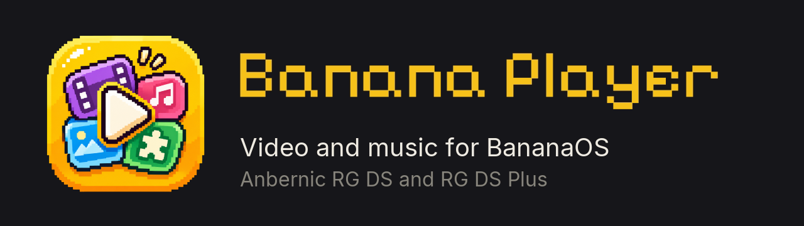

  

  <b>A dual-screen media player for BananaOS on the RG DS and RG DS Plus: movies, music, photos, manga and books, from your card or your network, with a companion web dashboard.</b>

  <a href="#install">Install</a> ·
  <a href="#the-buttons-you-need">Buttons</a> ·
  <a href="FEATURES.md">All features</a> ·
  <a href="#need-help">Help</a>

<table>
  <tr>
    <td align="center" width="33%"></td>
    <td align="center" width="33%"></td>
    <td align="center" width="33%"></td>
  </tr>
  <tr>
    <td align="center" width="33%"></td>
    <td align="center" width="33%"></td>
    <td align="center" width="33%"></td>
  </tr>
</table>

## What it does

- 🎬 **Movies:** MP4, MKV and more. Switch subtitles and audio tracks mid-film, jump between chapters, pick up where you stopped.
- 🎵 **Music:** a folder plays as an album, with its cover, a visualizer and a 10-band equalizer.
- 🖼️ **Photos:** zoom in and look around with a finger.
- 📖 **Manga:** CBZ, CBR and PDF chapters across both screens, or hold the handheld sideways like a book. An optional extension. Banana Player includes no manga sources: you're responsible for what you add.
- 📚 **Books and documents:** TXT and EPUB in a reader of their own (fonts, sizes, warm filter, bookmarks, find, a book mode across both screens); PDFs page by page or as one long scroll. Even very large text files open at once.
- 🗂️ **Files:** copy, move, rename and delete on the handheld, between both cards, with a progress bar.
- 📡 **Your network:** play straight from your computer or NAS over Wi-Fi, nothing copied.
- 🌐 **Web dashboard:** upload files, make playlists and control playback from your phone or computer.
- 🕶️ **Incognito mode:** while it's on, nothing you play is remembered.
- 🔄 **Updates in one tap**, with your settings kept.

## Visualizers

Fifteen looks for your music, drawn in your theme's colours, picked on **View › Display** (**SELECT**) while a song plays. Each one also works with the album art.

<table>
  <tr>
    <td align="center" width="20%"> Peaks</td>
    <td align="center" width="20%"> Ribbon</td>
    <td align="center" width="20%"> Mirror bars</td>
    <td align="center" width="20%"> Faders</td>
    <td align="center" width="20%"> Horizon</td>
  </tr>
  <tr>
    <td align="center" width="20%"> Grid</td>
    <td align="center" width="20%"> Starfield</td>
    <td align="center" width="20%"> Strings</td>
    <td align="center" width="20%"> Helix</td>
    <td align="center" width="20%"> Sparks</td>
  </tr>
  <tr>
    <td align="center" width="20%"> Bouncy keys</td>
    <td align="center" width="20%"> Rocket</td>
    <td align="center" width="20%"> Lanterns</td>
    <td align="center" width="20%"> Sleepy moon</td>
    <td align="center" width="20%"> Dance line</td>
  </tr>
</table>

## Install

**From the BananaOS Store (easiest):** open the **Store** on your handheld, find **Banana Player** and install it. The
Store keeps it up to date with each release.

**Or by hand, on the Ports shelf:**

1. **Download** `BananaPlayer-0.9.8-aarch64.zip` from the [latest release](https://github.com/tonywei92/banana-player/releases/tag/v0.9.8).
2. **Unzip it into `roms/ports`** on your SD card. You should see `Banana Player.sh`, a `BananaPlayer` folder and a
   `media` folder there.
3. **Open the Ports shelf** on the handheld and choose **Banana Player**.

Put your videos, music and photos anywhere on the card. Most 1080p videos play smoothly; very high bitrates and HEVC
(x265) may stutter.

## The buttons you need

| Button | What it does |
|---|---|
| **A** | Open, play, pause |
| **B** | Back (on Home: quit) |
| **L / R** | Previous / next |
| **START** | Menu and Settings |
| **Menu/Function** | Quick settings: volume, brightness, web dashboard |
| **F + START** | Quit straight away |

Everything also works by touch, and the bottom line of each screen shows its buttons. The full list is in
**[FEATURES.md](FEATURES.md)**.

## Need help?

Put the SD card in a computer and attach `home/.config/banana-player/log.txt` (and `crash.log` if there is one) to an
[issue](https://github.com/tonywei92/banana-player/issues).

To uninstall, delete `Banana Player.sh`, the `BananaPlayer` folder and `media/box/Banana Player.png` from `roms/ports`.

Want to build it or help out? See [DEVELOPMENT.md](DEVELOPMENT.md).

## Support

  

Banana Player is free and always will be. If it makes your handheld better and you'd like to say thanks:
☕ [buy me a coffee on Ko-fi](https://ko-fi.com/tonysong). Entirely optional: every feature is for everyone. ❤️

## Credits

- Made by [tonywei92](https://github.com/tonywei92) for [BananaOS](https://github.com/JorreFog/BananaLinux) by
  JorreFog and the Banana contributors.
- Built on [mpv](https://mpv.io), [FFmpeg](https://ffmpeg.org) and [SDL](https://libsdl.org); network folders with
  [libsmb2](https://github.com/sahlberg/libsmb2) (LGPL 2.1) and [libcurl](https://curl.se).
- The manga reader uses [Lua](https://www.lua.org) (MIT), [lexbor](https://github.com/lexbor/lexbor) (Apache 2.0) and
  [libjpeg-turbo](https://libjpeg-turbo.org) (BSD-style). Its optional manga engine,
  [Suwayomi-Server](https://github.com/Suwayomi/Suwayomi-Server) (MPL 2.0) on a Java runtime, is downloaded only if
  you ask for it.
- The web dashboard uses [cpp-httplib](https://github.com/yhirose/cpp-httplib) (MIT),
  [QR-Code-generator](https://github.com/nayuki/QR-Code-generator) by Project Nayuki (MIT),
  [htm](https://github.com/developit/htm) with [Preact](https://preactjs.com) (Apache 2.0 and MIT) and
  [SortableJS](https://sortablejs.github.io/Sortable/) (MIT).
- Fonts: [Pixelify Sans](https://github.com/eifetx/Pixelify-Sans), [Inter](https://github.com/rsms/inter),
  [Fusion Pixel](https://github.com/TakWolf/fusion-pixel-font) and [Noto Sans](https://notofonts.github.io) Thai,
  Arabic, Hebrew and Devanagari (SIL Open Font License 1.1).
- The film in the screenshots is [Big Buck Bunny](https://peach.blender.org), © copyright Blender Foundation |
  www.bigbuckbunny.org, under [CC BY 3.0](https://creativecommons.org/licenses/by/3.0/) (subtitles and chapters added
  for the pictures). The manga page was made for Banana Player; the music and its cover are generated.

## No warranty

Banana Player is free and comes **as is, with no warranty**: use it at your own risk. The authors aren't responsible
for any damage to your handheld, lost files, or anything else that happens from using it. Manga sources are run by
third parties, and Banana Player doesn't host or vouch for what they serve. BananaOS is a separate project that
doesn't endorse Banana Player.

## Licence

[MIT](LICENSE) © tonywei92. You're free to use, change and share Banana Player; copies and forks must keep the
copyright notice and the licence.
